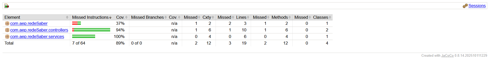

## Rede Saber
Plataforma de compartilhamento de materiais acadêmicos

---

## Objetivo

O **Rede Saber** é uma aplicação desenvolvida como uma Prova de Conceito (PoC) para demonstrar a aplicação prática de conceitos de Engenharia de Software, Programação Orientada a Objetos, banco de dados NoSQL, versionamento e testes automatizados.

A solução permite centralizar materiais acadêmicos e facilitar seu compartilhamento e consulta entre estudantes, além de possibilitar o gerenciamento de usuários e avaliações dos materiais disponibilizados.

O projeto está alinhado ao:

> **ODS 4 – Educação de Qualidade**

---

## Tecnologias utilizadas

| Tecnologia | Utilização |
|---|---|
| **Java 25** | Linguagem principal do backend |
| **Spring Boot 4.1.1** | Desenvolvimento da aplicação |
| **Spring Web MVC** | Construção da API REST |
| **Spring Data MongoDB** | Persistência e acesso aos dados |
| **MongoDB** | Banco de dados NoSQL |
| **Spring Security** | Configuração de segurança e gerenciamento de sessão |
| **Angular** | Desenvolvimento do frontend |
| **TypeScript** | Linguagem utilizada no frontend |
| **HTML e CSS** | Estrutura e estilização da interface |
| **JUnit** | Testes automatizados |
| **Mockito** | Testes unitários e simulação de dependências |
| **AssertJ** | Verificações e validações nos testes |
| **JaCoCo 0.8.14** | Medição da cobertura de testes |
| **Maven** | Gerenciamento de dependências e execução do backend |
| **Lombok** | Redução de código boilerplate |
| **Springdoc OpenAPI** | Documentação da API |
| **Docker Compose** | Inicialização dos serviços de infraestrutura |

As tecnologias do backend estão configuradas no `pom.xml` do projeto. O frontend possui suas próprias dependências e configurações.

---

# Pré-requisitos

Antes de executar o projeto, é necessário possuir as seguintes ferramentas instaladas:

### Java 25

O backend está configurado para utilizar **Java 25**.

Verifique a instalação com:

```bash
java -version
```

O resultado deve indicar uma versão compatível com Java 25.

### Maven

O projeto possui **Maven Wrapper**, portanto não é obrigatório instalar o Maven separadamente.

O repositório contém:

```text
mvnw
mvnw.cmd
```

Isso permite executar os comandos Maven diretamente pelo projeto.

### Node.js e npm

O frontend utiliza Angular. Para instalar suas dependências e executar a aplicação, é necessário possuir o **Node.js** e o **npm** instalados.

Verifique as instalações com:

```bash
node -v
npm -v
```

### MongoDB

O sistema utiliza o **MongoDB** como banco de dados NoSQL.

A infraestrutura pode ser inicializada utilizando o Docker Compose disponibilizado no projeto.

A aplicação está configurada para acessar:

```text
mongodb://localhost:27017/User
```

O MongoDB deve estar em execução antes de iniciar o backend.

---

# Clonando o projeto

Clone o repositório:

```bash
git clone https://github.com/GuilhermeFideliscch/AEP_2026_6S.git
```

Entre na pasta:

```bash
cd AEP_2026_6S
```

Para utilizar a versão atualmente em desenvolvimento:

```bash
git checkout desenvolvimento
```

---

# Executando a aplicação

A aplicação é dividida em duas partes: **backend**, desenvolvido com Spring Boot, e **frontend**, desenvolvido com Angular.

## Inicializando o MongoDB

Na raiz do projeto, execute:

```bash
docker-compose up -d
```

Esse comando inicializa os serviços configurados no Docker Compose.

## Executando o backend

### Windows

Na raiz do projeto, execute:

```bash
.\mvnw.cmd spring-boot:run
```

### Linux / macOS

```bash
./mvnw spring-boot:run
```

Após a inicialização, a API ficará disponível em:

```text
http://localhost:8080
```

A documentação da API pode ser acessada pelo Swagger UI, caso habilitada na configuração:

```text
http://localhost:8080/swagger-ui/index.html
```

## Executando o frontend

Entre na pasta do frontend:

```bash
cd rede-saber-front
```

Instale as dependências:

```bash
npm install
```

Execute a aplicação Angular:

```bash
npx ng serve
```

Após a inicialização, o frontend ficará disponível em:

```text
http://localhost:4200
```

O frontend realiza as requisições HTTP para o backend na porta `8080`, utilizando credenciais para manter a sessão do usuário autenticado.

---

# Funcionalidades da aplicação

O Rede Saber disponibiliza funcionalidades para o gerenciamento de usuários, materiais acadêmicos e avaliações.

### Usuários

- Cadastro de usuários;
- Login e logout;
- Consulta de usuários;
- Consulta individual;
- Atualização de dados;
- Exclusão de usuários.

### Materiais

- Cadastro de materiais acadêmicos;
- Consulta dos materiais;
- Consulta dos materiais vinculados ao usuário autenticado;
- Atualização de materiais;
- Exclusão de materiais;
- Armazenamento de comentários associados aos materiais.

O usuário responsável pelo cadastro de um material é associado automaticamente pelo backend, utilizando a sessão autenticada. Dessa forma, não é necessário informar manualmente o identificador do usuário no frontend.

### Avaliações

- Cadastro de avaliações;
- Consulta de avaliações;
- Consulta de avaliações por material;
- Atualização de avaliações;
- Exclusão de avaliações.

Cada avaliação está associada ao usuário que a realizou e ao material avaliado.

---

# Estrutura do banco de dados

O projeto utiliza o MongoDB, um banco de dados NoSQL orientado a documentos. Os dados são organizados em coleções, permitindo armazenar documentos com estruturas específicas para cada entidade.

As principais coleções utilizadas pela aplicação são:

## Coleção `users`

Armazena os dados dos usuários cadastrados.

Principais campos:

| Campo | Descrição |
|---|---|
| `_id` | Identificador do usuário |
| `nome` | Nome do usuário |
| `email` | Endereço de e-mail |
| `senha` | Senha armazenada pelo backend |
| `telefone` | Telefone do usuário |
| `ativo` | Situação do usuário |
| `dataCriacao` | Data de criação do cadastro |
| `enderecos` | Lista de endereços associados ao usuário |

Os endereços possuem os seguintes campos:

- `rua`
- `cidade`
- `estado`

## Coleção `materiais`

Armazena os materiais acadêmicos compartilhados pelos usuários.

Principais campos:

| Campo | Descrição |
|---|---|
| `_id` | Identificador do material |
| `titulo` | Título do material |
| `descricao` | Descrição do conteúdo |
| `linkArquivo` | Link para acesso ao arquivo |
| `usuarioId` | Identificador do usuário responsável pelo material |
| `comentarios` | Lista de comentários associados ao material |

Os comentários possuem o campo:

- `texto`

O campo `usuarioId` estabelece a associação entre o material e seu usuário responsável.

## Coleção `avaliacoes`

Armazena as avaliações realizadas sobre os materiais acadêmicos.

Principais campos:

| Campo | Descrição |
|---|---|
| `_id` | Identificador da avaliação |
| `nota` | Nota atribuída ao material |
| `comentarioGeral` | Comentário geral da avaliação |
| `usuarioId` | Identificador do usuário que realizou a avaliação |
| `materialId` | Identificador do material avaliado |
| `criterios` | Lista de critérios utilizados na avaliação |

Cada critério possui:

- `nome`
- `peso`

O campo `usuarioId` identifica o avaliador, enquanto `materialId` estabelece a associação com o material avaliado.

---

# Testes automatizados

Os testes automatizados fazem parte do projeto e estão localizados em:

```text
src/
└── test/
    └── java/
        └── com/
            └── aep/
                └── redeSaber/
                    ├── controllers/
                    │   ├── AvaliacaoControllerTest.java
                    │   ├── MaterialControllerTest.java
                    │   └── UserControllerTest.java
                    │
                    ├── services/
                    │   ├── AvaliacaoServiceTest.java
                    │   ├── MaterialServiceTest.java
                    │   └── UserServiceTest.java
                    │
                    ├── exceptions/
                    │   ├── GlobalExceptionHandlerTest.java
                    │   └── ResourceNotFoundExceptionTest.java
                    │
                    └── RedeSaberApplicationTests.java
```

Os testes abrangem principalmente as camadas de **Controller** e **Service**, além do tratamento global de exceções e da inicialização da aplicação.

Os testes de serviço utilizam **JUnit 5, Mockito e AssertJ**, com mocks para simular o comportamento das dependências.

Os testes dos controllers verificam o comportamento dos endpoints HTTP, incluindo códigos de resposta e operações realizadas pelos serviços.

---

## Como executar os testes

Para executar todos os testes:

```bash
./mvnw clean verify
```

No Windows:

```bash
.\mvnw.cmd clean verify
```

O Maven irá compilar o projeto, executar os testes automatizados e apresentar no terminal o resultado da execução.

Um resultado de sucesso deve apresentar:

```text
BUILD SUCCESS
```

---

# Cobertura dos testes

A cobertura dos testes é calculada utilizando o **JaCoCo**.

O projeto está configurado para gerar automaticamente o relatório durante a execução dos testes e possui um percentual mínimo de cobertura global de **70%**.

Para executar os testes e gerar o relatório de cobertura:

```bash
./mvnw clean verify
```

O relatório será gerado em:

```text
target/site/jacoco/index.html
```

---

## Como visualizar o relatório do JaCoCo

Depois de executar os testes, abra o arquivo:

```text
target/site/jacoco/index.html
```

no navegador.

Também é possível navegar pelo relatório para visualizar a cobertura por:

- Projeto;
- Pacote;
- Classe;
- Método;
- Linhas de código.

O JaCoCo permite identificar quais partes do código foram executadas pelos testes automatizados.

---

# Evidência da cobertura de testes

Exemplo de relatório do JaCoCo:



---

# Estrutura do projeto

A estrutura principal do projeto está organizada da seguinte maneira:

```text
AEP_2026_6S/
│
├── .mvn/
│   └── wrapper/
│
├── src/
│   ├── main/
│   │   ├── java/
│   │   │   └── com/
│   │   │       └── aep/
│   │   │           └── redeSaber/
│   │   │               ├── controllers/
│   │   │               ├── exceptions/
│   │   │               ├── models/
│   │   │               ├── repositories/
│   │   │               ├── security/
│   │   │               ├── services/
│   │   │               └── RedeSaberApplication.java
│   │   │
│   │   └── resources/
│   │       ├── db/
│   │       │   └── migration/
│   │       └── application.properties
│   │
│   └── test/
│       └── java/
│           └── com/
│               └── aep/
│                   └── redeSaber/
│                       ├── controllers/
│                       ├── exceptions/
│                       ├── services/
│                       └── RedeSaberApplicationTests.java
│
├── rede-saber-front/
│   ├── src/
│   │   └── app/
│   │       ├── app.component.ts
│   │       ├── app.component.html
│   │       └── app.component.css
│   ├── package.json
│   └── angular.json
│
├── docker-compose.yml
├── pom.xml
├── mvnw
├── mvnw.cmd
├── .gitignore
└── README.md
```

A organização separa as responsabilidades entre **controllers, models, repositories e services** no backend, enquanto o frontend concentra a interface e a comunicação com a API.

---

## Equipe

| RA | Nome |
|---|---|
| 24170521-2 | Guilherme Fidelis Candido Chiquito |
| 24000499-2 | João Ricardo Barbiero de Souza |
| 24151606-2 | Gabriel Delefrati Ferreira |
